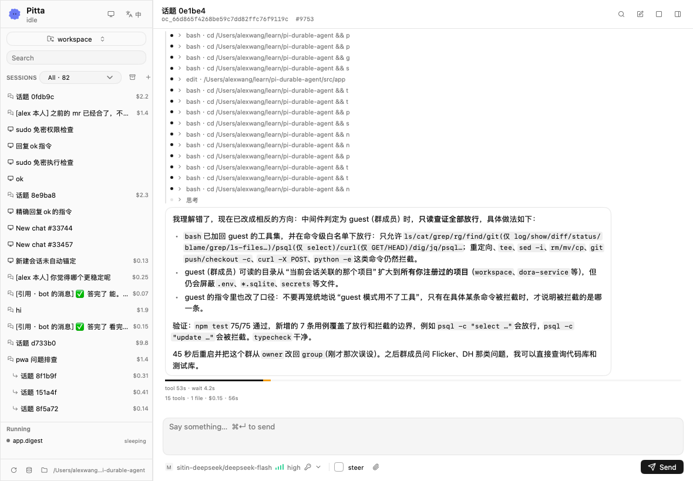
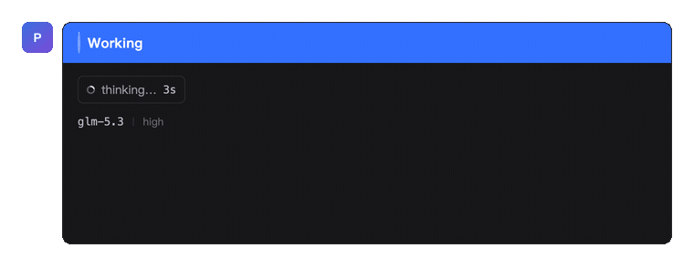
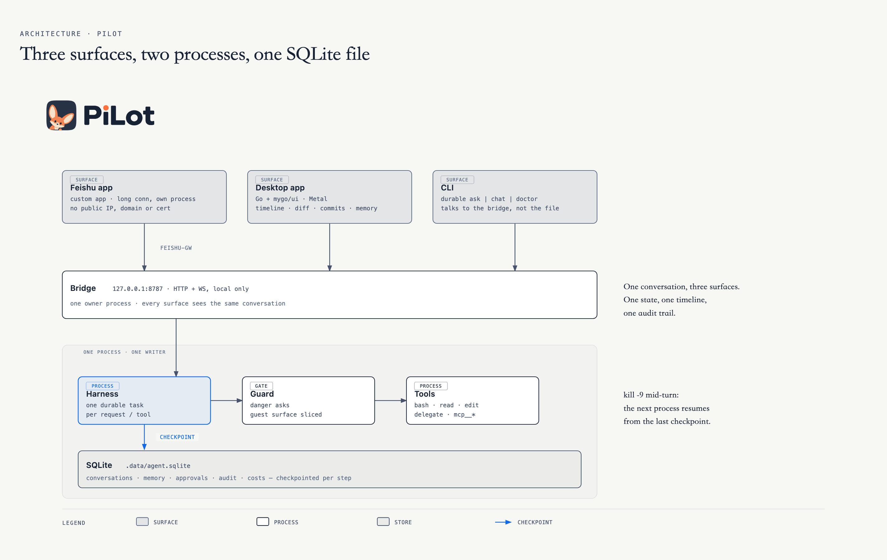
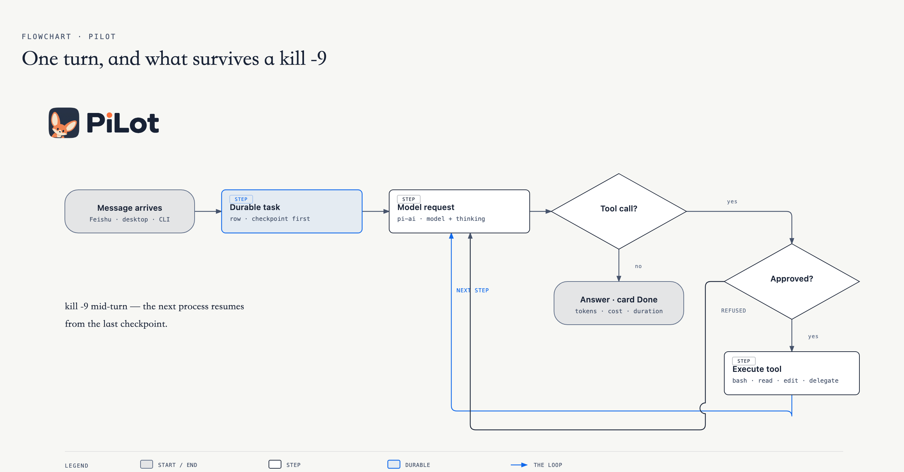
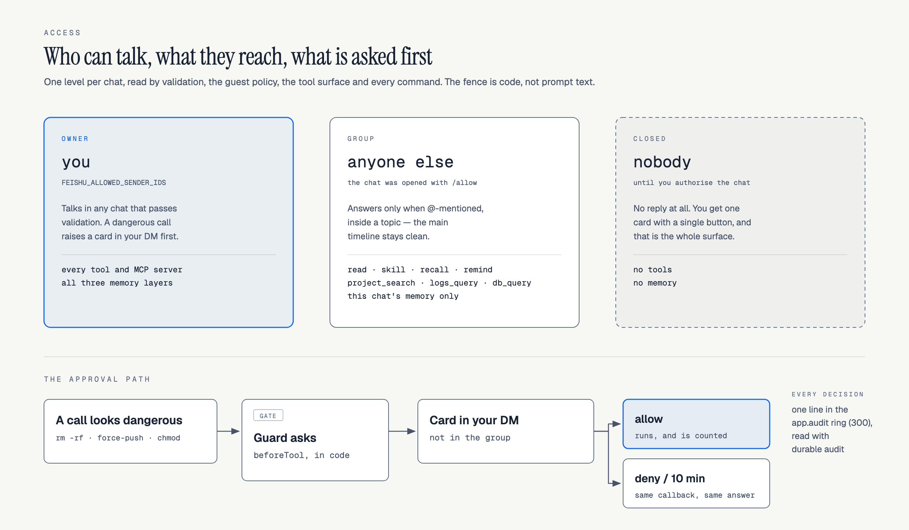

<p align="center">
  <picture>
    <source media="(prefers-color-scheme: dark)" srcset="assets/readme/logo-dark.png">
    
  </picture>
</p>

<p align="center"><strong>English</strong> · <a href="README.zh-CN.md">中文</a></p>

<p align="center"><em>PiLot: one Pi, a lot of possibilities.</em></p>

<p align="center">
  
  
  
  
</p>

A personal assistant that runs on [Pi Durable](https://earendil.com/posts/pi-durable/): talk to it in Feishu, watch it work in a desktop app, use it from a terminal — and if the process dies, the conversation does not.





```bash
git clone https://github.com/ziludev/PiLot.git && cd PiLot && ./bin/durable setup
```

Six steps, then it runs — [Install](#install) has the details and the two things only you can do.

## Three things hold the rest together

**A turn is a durable task.** Every model request, tool call and compaction writes its row before it
runs. `kill -9` halfway through and the next process marks the interrupted call, retries it, and
finishes where the turn would have finished: conversation ids, memory, queues and card
registrations are all where you left them. The engine is `@earendil-works/pi-durable` 1.5.2; the
models come from `@earendil-works/pi-ai`, and model plus thinking level are switchable per
conversation.

**One conversation, three faces.** A Feishu group, the macOS window and `durable chat` are three
readers of one bridge and one SQLite file. A turn started in a group streams into the window
without a refresh; `/stop` from the terminal stops the turn the card is showing. None of them is the
"real" one.

**The fence is code.** Who may talk, what they may reach, and what is asked first are one value per
chat — `closed`, `owner` or `group` — read by validation, the guest policy, the tool surface and
every command. A dangerous call waits for your tap in your DM, and nobody tapping within ten minutes
means no. The model never grants itself anything by asking nicely.



## A turn, end to end



A message becomes a durable task inside the bridge. The model answers, or asks for a tool; a tool
call that looks dangerous stops at the guard; the call runs in a separate process; the result goes
back to the model. That loop is the whole assistant, and every step of it survives the machine.

A turn reads as steps, not a log. The transcript keeps one line per turn and opening it lists what
each step was, whether it failed, and what it printed:

```
⋯ 4 steps · 12s
  bash     cd ~/work/example-cli && timeout 90 node dist
  bash     python3 - <<'EOF' import json,re …
  thought
```

The same turn folds into the Feishu card as `Turn details · 5 steps · 62s · $0.0031`, so both
surfaces count it the same way. An approval that waited sits inside that span, which is why a
twelve-second turn can be mostly waiting. A failed step keeps its error in the timeline and puts a
Retry on the line — the same words go out again instead of being retyped.

### The card says how it ended

A patch in Feishu rebuilds the whole card, so the status band has to be sent with every refresh —
otherwise it disappears on the first streaming update.

| band | meaning |
|---|---|
| blue `Working` | the turn is running |
| green `Done` / `Goal met` | answered — `Goal met` when the model filed a verdict via `report_done` (says so when the turn needed a continuation) |
| orange `Goal missed` | the model declared the goal was not reached; the panel says where it got stuck |
| orange `Stopped at N steps` | hit `AGENT_MAX_TURNS`, progress kept |
| grey `No answer this time · reason` | ended without an answer |
| red `Failed` | the turn threw |

`Goal met` / `Goal missed` are the model's own claim, not ours: on a turn where it did work it calls
`report_done({ met, why })` before it answers, so `why` is how it verified (what it ran, what it saw)
or where it got stuck. A turn that declares nothing keeps the plain `Done` — silence is not failure.
The claim is read once by the card, written once to `app.turn-verdicts`, and shows up in both the
decision trail and the morning digest.

The orange and grey cards carry a **Continue** button: it runs the same turn again inside the *same
card*, and a double tap still starts only one turn. The card's Continue and `/continue` in `durable
chat` are the same path. The same panel opens the turn's **decision trail** — what had to be asked,
how long it waited, whether you allowed it, why it ended — because "what ran" does not explain a
two-minute pause.

## What it does

| | |
|---|---|
| Feishu | One conversation per chat. In groups it answers only when @-mentioned, in a topic, so the main timeline stays clean; a follow-up inside that topic forks its own conversation. |
| Desktop | One rail of conversations, filed by kind — 群聊, 话题, 私聊 — with everything that spoke in the last day drawn open on top, each chat showing what it has cost, and a Tasks page for runs, reminders and routines. Light and dark, 中文 and English. |
| Model | `/model` opens a card to switch the conversation's model; `/model <id>`, `/model thinking high`, `/model default <id>` also work. Only the owner may use it. Each answered card names the model, thinking level, tokens and cost of that turn. |
| Input | Text, images (Feishu image/post messages, pasted screenshots), voice (local whisper). |
| Interrupt | `/stop` or the client's stop button. Background tasks keep running. |
| Steering | `/steer <text>` skips the queue and goes into the run that is already going, landing at the next tool-call boundary (idle, it is just a message). Plain messages still queue — a stray "wait…" sent mid-run should not bend the work in flight. Underneath it is pi-durable's `whenBusy: "steer"`, one steer per boundary by default. |
| Notifications | A Feishu card answer is an *update*, and Feishu does not notify on updates. So a turn longer than 45 s also sends one short message (`✅ done · 53s` plus the first line), in the same topic. `FEISHU_DONE_PING_SECONDS` tunes it, `0` turns it off. |
| Morning digest | Once a day at `AGENT_DIGEST_AT` the owner gets one message covering the last 12 hours: how many turns ran and how many declared the goal met, every turn that fell short with the reason it gave, approvals, and the audit tail. A quiet night sends nothing. `/digest` (or `/早报`) asks for it on demand. |
| Catch up | `/ketchup` (或 `/进度`) answers "what happened?" without scrolling: runs in flight, tasks queued behind them, every approval still waiting on you with how long it has waited, and the last few audit rows. Owner only, because the approval lines name your own tool calls. |

A turn that fails puts a Retry on its error line, and stop clears that conversation's approval
queue rather than killing the turn.

### Sessions and projects

- **project** = a git repository on this machine; the bundled `workspace/` is the default one and cannot be removed.
- **chat** = a conversation inside a project, with its own worktree at `<project>/.worktrees/conv-<id>` on branch `agent/conv-<id>`.

Each conversation records its **fork point** and **current base**; the base can be changed, and
cleaning up a worktree with unmerged commits is refused. The bridge can diff that worktree, commit
it, and merge it back `--no-ff` — `/api/changes` and `/api/git` are what the previous client's diff
and commit panels were built on. The Go client does not draw those panels yet; you ask for a diff,
or read the branch yourself.

`workspace/` and every `.worktrees/` directory are written to the repository's own
`.git/info/exclude`: `git status` stays clean, and the user's `.gitignore` is never touched.

## Memory

| layer | holds | injected |
|---|---|---|
| `global_memory` | stable facts and preferences about you | last 60 |
| `chat_memory` | context for this conversation | last 20 |
| `work_memory` | project and environment details | only an index line; found via `recall` |

Tools `remember(scope)`, `forget`, `recall`. Per-chat notes use `/memo`, `/memo add …`,
`/memo del 2`, `/memo clear`, which write that conversation's `chat_memory`. Deleted memories go to
`app/memory-tombstones` so the model cannot resurrect them, and deduplication uses character bigram
similarity, so a rephrasing is still recognised. Curating reads recent conversations and produces
*suggestions* only (`POST /api/memory/curate`); nothing is written until you accept them. The Go
client has no button for it yet, so it takes a request.

## Access and cost



| who | may talk when | tool surface (enforced in code) | memory |
|---|---|---|---|
| you (`FEISHU_ALLOWED_SENDER_IDS`) | chat is allowed | everything; dangerous calls raise an approval card in your DM | all layers |
| anyone else in an allowed group | the group was opened | `read` (workspace and this conversation's project, sensitive files refused), `skill`, `recall`, `remind`, `project_search`, `logs_query`, `db_query` (both read-only, dev and prod) | this chat only |
| nobody has authorised the chat | level is `closed` | no reply; you get one card with a single button | — |

- **`FEISHU_ALLOWED_SENDER_IDS` is required.** It defines both "who is the owner" and "who may tap an approval". Empty means no owner, so the Feishu bridge refuses to start and says why.
- **The guest surface is code, not prompt text.** A non-owner turn gets the tools above and nothing else: `bash`, `write`, `edit`, `feishu_*`, `mcp__*` and `delegate` are refused in `beforeTool`. Memory has the same fence: a guest turn neither reads `global_memory` nor writes outside its chat.
- Every message carries its speaker (`[owner …]` / `[member …]`). The model does not trust the prompt's claim about identity; it reads the annotation, and the tool surface follows it.
- **Approvals** land in your DM, not the group. The decision is stored in a durable memo, so a restart does not ask again; only the listed open_ids can tap it; **nobody tapping within 10 minutes means denied**, through the same callback as a manual deny, and the card says so. The same pending approval appears in the client's amber bar; either place decides, and with no approval channel at all the answer is no.
- **Allow in this chat** has two answers: *this kind* is remembered per risk class (`rm`, `force-push`, `write-outside`, `chmod-777`, …), *everything* covers every class in the conversation except `sudo`, `rm`, `pipe-to-shell`, disk writes and shutdown. Both live in `app.session-grants` and survive a restart; other conversations still ask.
- **Audit**: denials, level changes, approval outcomes and the two read-only queries each write one line to `app.audit` (ring of 300), readable with `durable audit`.
- **Budget**: `pi.usage` is summed into a daily cap (`AGENT_DAILY_BUDGET_USD`); over it, new requests are refused until the day rolls over.

## Scheduled work

`remind` creates a durable reminder task: the deadline is in the database, the task sleeps, and a
restart does not lose it. Running tasks show in the client's Tasks page, grouped working / waiting /
sleeping, each with its next fire time and how long it has been running.

`routine` is the same durable sleep with a turn behind it: it wakes, starts a full turn in the chat
(`daily 09:00` / `weekdays 09:00` / `weekly mon 09:00` / `every 6h`), then goes back to sleep — a
route that never ends, so the ledger is the schedule. Because it sleeps on a stored deadline, a fire
that falls while the machine is off happens once when it comes back, not the whole backlog.
`routines` lists them and cancels one.

`POST /api/hook/<name>` is the same door for things that are not Feishu: a git hook, an SLS alarm, a
cron on another box. It starts a real turn in the owner's chat and returns 202 immediately, since
the turn takes minutes and the caller should not hold a socket for it. Same bearer token as every
other endpoint here.

## Processes

Three processes, not one:

- **`src/`** — the bridge. Holds the conversations, the queue, the card state and the only write
  handle to the database.
- **`feishu-gw/`** — the Feishu long connection, on its own launchd job, talking to the bridge over
  `127.0.0.1:8788`. A message event becomes a turn that runs for minutes, so the socket has to be
  free the moment the event lands: it acks Feishu first and forwards in the background, retrying at
  0 s, 1 s, 2 s and 4 s. A card click is the opposite shape — Feishu gives up after about three
  seconds — so that path stays synchronous, budgeted at 2.5 s.
- **`toolbox-go/`** — `bash`, `read`, `write` and `edit` as a Go service on a unix socket. The model
  sees the same schemas and result shapes as before; the Node side keeps a thin proxy. Why this is
  a process and how parity is asserted: [docs/toolbox.md](docs/toolbox.md).

A transport restart no longer restarts the agent, and a turn no longer holds the socket open.
`./scripts/agentctl status` prints `feishu: ok (gateway connected)` or how long it has been down.

## Extensions

Skills are scanned from `./.pi/skills`, `./.agents/skills`, `~/.pi/agent/skills`,
`~/.agents/skills`, `~/.claude/skills`; only names go into the prompt and the `skill` tool fetches a
body on demand. MCP servers from `mcp.json` (stdio or streamable HTTP) are connected at startup and
their tools registered as `mcp__<server>__<tool>`; a server may list `only` to expose a subset, since
every tool's schema rides in each request and playwright's 25 tools are ~17KB of it.

`delegate`, `delegate_parallel` and `build_feature` run sub-agents as task-owned conversations: they
resume after a crash, abort in cascade, and nest one level. `build_feature` ends with a reviewer that
reads the diff, not the reports. `spawn_agent` / `tell_agent` / `list_agents` / `stop_agent` are the
other shape: a named, ownerless conversation that keeps its context, can be redirected mid-run, and
answers back as a message.

Feishu-native tools (`feishu_agenda`, `feishu_tasks`, `feishu_create_task`, `feishu_doc_read`) go
through a locally logged-in `lark-cli`, so they act as you.

## Configuration

Everything lives in `.env`; `.env.example` explains every key.

| key | what it does |
|---|---|
| `FEISHU_APP_ID`, `FEISHU_APP_SECRET` | the Feishu app; without them the bridge does not start |
| `FEISHU_GW_URL`, `FEISHU_GW_TOKEN` | where and with which token the bridge reaches the Feishu gateway (`feishu-gw/`) that holds the long connection |
| `FEISHU_ALLOWED_SENDER_IDS` | who is the owner — required, and the only people who may approve |
| `FEISHU_ALLOWED_CHAT_IDS` | chats pinned to `owner` level (empty: every chat starts `closed`) |
| `AGENT_OWNER_NAME` | the name the prompt uses for the owner; wording only, never a permission |
| `FEISHU_DONE_PING_SECONDS` | extra completion message for turns longer than this; `0` off |
| `AGENT_DIGEST_AT` | when the overnight digest arrives (`08:30`, Asia/Shanghai); `off` disables it |
| `AGENT_PROVIDER`, `AGENT_MODEL`, `AGENT_THINKING` | default provider, model and thinking level |
| `MAGPIE_BASE_URL`, `MAGPIE_API_KEY` | when `AGENT_PROVIDER=magpie`: a local OpenAI-compatible proxy |
| `AGENT_WORKSPACE`, `AGENT_DB` | the directory tools may touch, and the SQLite file |
| `AGENT_MAX_TURNS` | tool calls per turn before the card offers Continue (240; a runaway guard, not a budget) |
| `AGENT_DAILY_BUDGET_USD` | daily spend cap across all chats, `0` for none (currently off) |
| `AGENT_WORKTREE`, `AGENT_SKILLS_DIRS`, `AGENT_MCP_CONFIG` | worktree mode, skill directories, MCP config file |
| `AGENT_TOOLBOX_BIN` | the toolbox binary that serves `bash`/`read`/`write`/`edit`; rebuilt from `toolbox-go/` when stale |
| `AGENT_HTTP_PORT`, `AGENT_HTTP_HOST`, `AGENT_HTTP_TOKEN` | the local bridge the client and CLI use; `0` disables it |
| `SLS_LOGSTORE_PREFIX` | for `logs_query`: the logstore is named `<prefix>-<env>-stdout` |
| `PRESENCE_CLI` | the presence CLI that backs `logs_query` / `db_query`; defaults to `~/work/presence-cli/dist/index.js` |
| `AGENT_ASR` | local whisper transcription: `auto` or `off` |

## Install

macOS (launchd and the desktop client are macOS-only), Node 22+, `git`. `ffmpeg`, `whisper` and
`lark-cli` are optional extras for transcription, voice messages and the native Feishu tools. A Go
toolchain is needed to build `toolbox-go/`, which serves the coding tools (or ship a prebuilt binary).

```bash
git clone https://github.com/ziludev/PiLot.git && cd PiLot
./bin/durable setup
```

`setup` walks six steps and stops where you would otherwise guess:

1. **Node and dependencies** — checks the version, runs `npm install` if `node_modules` is missing.
2. **The model gateway** — DeepSeek, OpenAI, Anthropic, or a local OpenAI-compatible proxy. It asks
   for the key and the model id and writes both into `.env`.
3. **The Feishu app** — App ID and App Secret from 凭证与基础信息.
4. **Your open_id** — this is what makes you the owner. Left blank, every member of every group the
   bot joins would count as you, able to tap approvals and run code.
5. **A read-back of the console** — credentials, bot capability, delivery mode, published version,
   subscribed events, `card.action.trigger`, scopes, and whether the bot is in any chat. Each ✗ says
   which menu fixes it.
6. **launchd** — hands the job over so it starts at login and restarts after a crash.

What to click in the Feishu developer console (open.feishu.cn → your app) is one page:
**[docs/feishu-setup.md](docs/feishu-setup.md)** — bot capability, six scopes, long connection, one
callback, one event, and publishing. `setup`'s read-back names the same items, so a ✗ tells you
which row of that page you skipped.

Then:

```bash
durable doctor            # the same read-back, any time
./scripts/agentctl logs   # what the agent is doing
./scripts/agentctl status # pid, runs, exit code
```

**Why there is no one-click Feishu setup**: a Feishu custom app is tenant-scoped — its App ID and
secret can only be created by you, inside your own tenant (crossing tenants means an ISV app, an
OAuth flow and a marketplace review). So the automated part stops exactly at that wall: everything
after the two credentials is scripted and verified. Colleagues in the same tenant can share one app
and each run their own instance; the owner list decides who controls what.

### Desktop client

```bash
cd client-go
go run .                         # the window, connected to the local bridge
go tool mygo build -skip-dmg     # build/darwin-arm64/PiLot.app
rsync -a --delete build/darwin-arm64/PiLot.app ~/Applications/   # then `open ~/Applications/PiLot.app`
```

The window is drawn by mygo/ui from Go: no webview, no front-end build step, no runtime to
ship. Screens and key bindings are in [client-go/README.md](client-go/README.md); it reads the
open conversation as frames over a websocket, so a turn started on Feishu arrives in the window
without a refresh and the two surfaces are never looking at different conversations.

The client it replaced was a webview page backed by the bridge, and before that a Go client with
diff, commit, access and ops panels; both are deleted, not parked. What the first of them could do
and this one cannot is [client-go/docs/gaps.md](client-go/docs/gaps.md) — the endpoints are still
live, so each line there is client work, not a feature request.

## CLI

```bash
ln -sf "$PWD/bin/durable" ~/.local/bin/durable

durable                 # command overview
durable setup           # guided install: deps, gateway, Feishu, checks, launchd
durable doctor          # local and Feishu checks
durable ask "…"         # one question, streamed
durable chat            # multi-turn REPL (/new /stop /exit)
durable sessions        # conversations: id, source, project, title
durable approvals       # pending approvals; durable approve <id> / deny <id>
durable access          # each conversation's level and where approval cards go
durable audit [n]       # the last n permission decisions
```

Conversation commands go through the local HTTP/WS bridge, so they work while launchd owns the
process. The name is `durable` because `agent` belongs to grok's CLI.

## Operations

```bash
./scripts/agentctl install          # render the plist and load it
./scripts/agentctl install-gateway  # the Feishu long connection, in its own process on :8788
./scripts/agentctl logs-gateway [n]
./scripts/agentctl install-backup   # a hot SQLite backup every day at 04:10
./scripts/agentctl start|stop|restart|status
./scripts/agentctl logs [n]
./scripts/agentctl doctor           # node/git, .env, DB, writer lock, process count, port, restarts, worktrees
./scripts/agentctl backup|backups|restore <file>
./scripts/agentctl rotate           # trim the logs now (5 MB × 3, `LOG_MAX_BYTES` overrides)
```

`agentctl` is a Go program (`agentctl/`, built to `bin/agentctl`); `./scripts/agentctl` is a shim
that rebuilds it when the sources are newer. Same commands, same launchd labels — the control logic
just stopped being a 357-line shell script that quoted its way into an `unexpected EOF`.

The reasons behind the writer lock, the storage self-heal, the log lines and `doctor`'s comparisons
are in **[docs/operations.md](docs/operations.md)** — each one was learned from a failure that
looked like something else.

## Layout

```
src/
  main.ts          entry: bridge, Feishu, graceful exit (a harness failure exits so launchd restarts)
  server.ts        local HTTP/WS bridge: the only door for the client and the CLI
  harness.ts       Harness.open, extensions, chat↔conversation map, project/base resolution
  feishu.ts        card streaming, buttons, images and voice, commands, budget gate — over the gateway
  feishu-gw.ts     a Feishu IM client that calls the gateway instead of Feishu: send, reply, patch, sender, attachments
  approval.ts      the guard hook: recognise a dangerous call, ask
  approvals.ts     the pending-approval registry shared by the Feishu card and the client
  access.ts        one level per chat (closed/owner/group), guest policy, owner DM
  cards.ts         pending card records and their phase (live → delivering → gone)
  details.ts       per-turn steps, seconds and cost, stored for the client
  decisions.ts     the turn's decision trail (what was asked, what you answered, why it ended)
  done.ts          the report_done tool and the verdict a card repeats
  verdicts.ts      the ring of verdicts the morning digest reads
  memory.ts        three memory layers; curator.ts suggests, never writes
  settle.ts        setting a final state: "already terminal / abort-marked / session closed" is not an error
  reminders.ts     durable reminder tasks (sleepUntil) and the remind tool
  routines.ts      recurring turns: a reminder that starts a turn and never settles
  projects.ts      projects, conversation↔project/base binding
  worktree.ts      one worktree and branch per conversation; merge back to the base
  git-info.ts      commits, a single patch, push, PR/MR links
  changes.ts       workspace status, unified diff, commit
  subagents.ts     delegate / delegate_parallel / build_feature
  agents.ts        named long-lived agents: spawn_agent / tell_agent / list_agents / stop_agent
  diagnostics.ts   the read-only tools guests get: project_search (rg, project scope), logs_query, db_query
  audit.ts         the ring of permission decisions (app.audit)
  digest.ts        the once-a-day message built from verdicts + audit, and its sleeping task
  ketchup.ts       the on-demand "what happened" read

evals/             the offline bench: guard (approval decisions) and contract (config ↔ .env.example ↔ README)
docs/              the pages with edges: the Feishu console, the toolbox, operations
client-go/         the desktop client: Go drawing the window with mygo/ui on Metal, no webview
feishu-gw/         the Feishu long connection as its own Go process: acks, forwards, uploads, downloads
agentctl/          install/start/stop/logs/doctor/backup as a Go program (bin/agentctl)
toolbox-go/        the coding tools as a Go service on a unix socket: bash, read, write, edit
```

## Behaviours that have been observed

| case | result |
|---|---|
| crash and resume | `kill -9` halfway through `sleep 10`; the new process marks the tool call interrupted, the model retries it in the background and answers |
| restart keeps state | conversation ids, memory, conversation↔project and card registrations unchanged; no re-delivery, because the claim (`live → delivering`) happens inside a transaction and only one process can take it |
| recycled pid | startup proceeds when `.data/agent.owner` names a pid now owned by something else (`ps` must show `node … main.ts` to refuse) |
| approval | `rm -rf` is refused, "allow" on the card or the client API approves it, the tool really runs, and the wait is counted in the timeline |
| worktree isolation | a file written in conversation A is invisible in the main tree and other conversations; after `--no-ff` it appears |
| sub-agents | designer → implementer → tester runs end to end, billed separately and resumed after a crash |

The rest of the evidence — images, unmerged-worktree refusal, the writer lock, 58 guard cases — lives
in `evals/` and `tests/`, where it runs instead of being read.

## Tests and evals

```bash
npm test                      # pure logic, node --test, seconds
npm run eval                  # guard and contract, no model needed
npm run eval -- --strict      # count known gaps as failures
npm run eval -- --json        # one envelope, for scripts
```

`tests/` pins function behaviour; `evals/` pins **contracts** — `approvalReason()` against 58 real
commands, and whether `config.ts`, `.env.example` and `README.md` still agree with each other. The
metric that matters is **escapes**: dangerous calls that ran with nobody asked. Known holes are not
hidden — a case is marked `gap: true`, listed in the output, red under `--strict`, and the bench
tells you to delete the marker once it passes. On its first run it caught nine keys missing from
`.env.example` and one wrong default. See `evals/README.md`.

## Known limits

- Tests cover pure logic and contracts, not end to end; both commands run in seconds.
- A turn stops after 240 tool calls (`AGENT_MAX_TURNS`). That is a runaway guard, not a budget: ordinary work here runs 100-150 calls, and a loop looks like hundreds within minutes. Money is capped by `AGENT_DAILY_BUDGET_USD` (currently `0`, off — the cap exists but nobody is running it). Stopping is not a failure — the card says so and offers Continue; the transcript is intact. A run that makes 40 calls in a row without changing anything is told to wrap up (that warning rides along with the tool result; see `src/stall.ts`).
- Pi Durable is **experimental** and changes between 1.x releases; run `npm run typecheck` before upgrading. It also pins chord: from 1.5.1 chord v2 is the package root, `Context` lives only in `@earendil-works/chord/context`, and importing it from the root fails to compile.
- SQLite runs with `synchronous=NORMAL`: a crash loses nothing, a power cut may lose the last commit.
- `bash` can in principle `cd` out of the workspace; the guard hook covers danger, it is not a sandbox.
- One-click Feishu setup across tenants is impossible (see [Install](#install)).
- Usage squares start on the day the sampler first ran; there is no per-day history before that.
- Feishu cards do not render Markdown, they render their own subset: no tables, no inline code, no headings, no quote blocks, no `---`. The card builder translates those (tables become native `table` elements, `##` becomes bold, `---` becomes a divider, inline backticks are stripped, `>` becomes `▸`); anything outside that set arrives as literal characters.
- A card holds 9000 characters. A longer answer is clipped at that limit with the code fence closed and an ellipsis, not split across cards; the longest real answer so far was 3543.
- The Go client covers the rail, the transcript, the composer and approvals. Diff, commit, file and memory-curation panels from the client before it are not back yet; their endpoints still answer, so nothing is lost but the buttons.
- This is a personal assistant, not a product: prompt text and some UI copy are Chinese, and the owner is a single hard-coded name.

## License

MIT. See [LICENSE](LICENSE).
