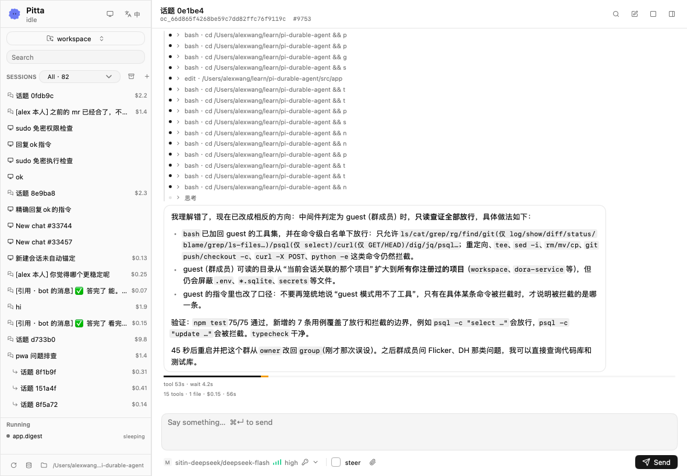
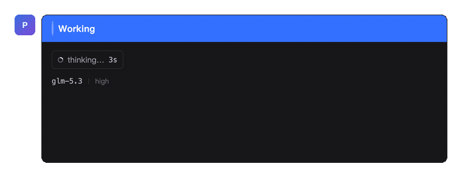
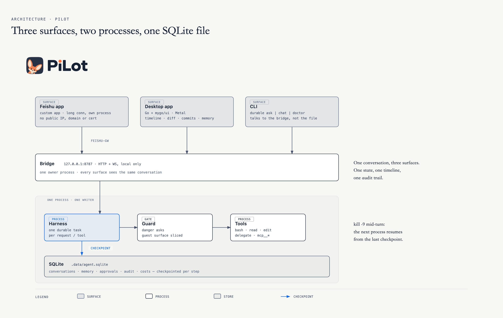
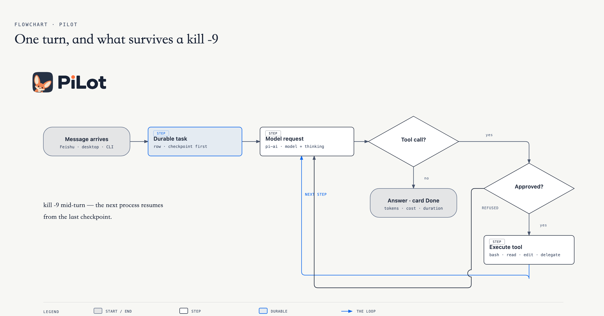
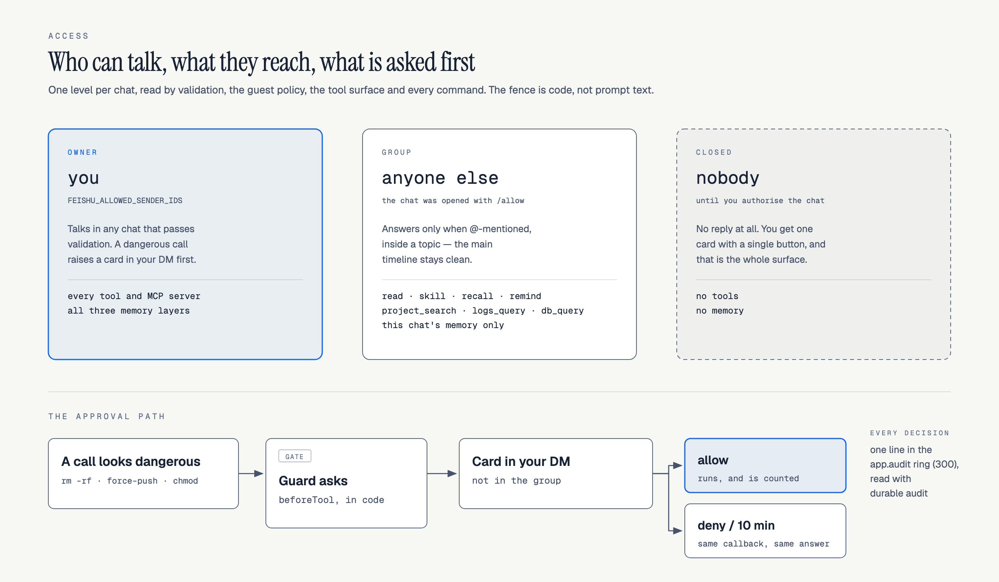

<p align="center">
  <picture>
    <source media="(prefers-color-scheme: dark)" srcset="assets/readme/logo-dark.png">
    
  </picture>
</p>

<p align="center"><a href="README.md">English</a> · <strong>中文</strong></p>

<p align="center"><em>PiLot：一个 Pi，无限可能。</em></p>

<p align="center">
  
  
  
  
</p>

跑在 [Pi Durable](https://earendil.com/posts/pi-durable/) 上的个人助理：飞书里聊、桌面上看、终端里也能用，进程挂了不丢对话。





```bash
git clone https://github.com/ziludev/PiLot.git && cd PiLot && ./bin/durable setup
```

六步之后它就跑起来了——[安装](#安装)里有细节，和那两件只有你能做的事。

## 三件事撑起其余全部

**一个 turn 就是一个 durable task。** 每次模型请求、每次工具调用、每次压缩，都是先写一行再执行。中途 `kill -9`，下一个进程把被打断的调用标出来、重试它，然后在这个 turn 本该结束的地方结束：会话 id、记忆、队列、卡片登记全在原处。引擎是 `@earendil-works/pi-durable` 1.5.2，模型来自 `@earendil-works/pi-ai`，模型和思考级别可以逐会话切换。

**一份会话，三个面孔。** 飞书群、macOS 窗口、`durable chat` 是同一个 bridge 和同一个 SQLite 文件的三个读者。群里起的一个 turn，会不刷新就流进窗口；终端里 `/stop` 停掉的，就是卡片上正在跑的那个。没有哪一个是「正本」。

**边界是代码。** 谁能说话、能碰到什么、什么要先问，是每个会话的一个值——`closed`、`owner` 或 `group`——由校验、访客策略、工具面和每一条命令读取。危险调用停在你的私聊里等你点，十分钟没人点就是拒绝。模型无法靠说好话给自己放权。



## 一个 turn 的全程



一条消息在 bridge 里变成 durable task。模型要么回答，要么要一个工具；看着危险的调用停在 guard；调用在另一个进程里执行；结果回到模型。这个循环就是全部，而它的每一步都扛得住机器挂掉。

一个 turn 读起来是步骤，不是日志。转写里每个 turn 留一行，点开就是每一步做了什么、有没有失败、打印了什么：

```
⋯ 4 steps · 12s
  bash     cd ~/work/example-cli && timeout 90 node dist
  bash     python3 - <<'EOF' import json,re …
  thought
```

同一个 turn 在飞书卡片里折成 `Turn details · 5 steps · 62s · $0.0031`，两个界面数的是同一份。等审批的时间也算在这段里——所以一个十二秒的 turn 可能大部分在等。失败的步骤把错误留在时间轴上，并在那一行给一个 Retry：原话再发一次，不用重打。

### 卡片自己说它怎么结束的

飞书的 patch 是重画整张卡，状态带必须每次刷新都发一遍，否则第一次流式更新就把它抹掉了。

| 状态带 | 含义 |
|---|---|
| 蓝 `Working` | turn 在跑 |
| 绿 `Done` / `Goal met` | 答完了——模型通过 `report_done` 交了结论时是 `Goal met`（需要续跑时会注明） |
| 橙 `Goal missed` | 模型自己说没达成；面板写它卡在哪 |
| 橙 `Stopped at N steps` | 撞到 `AGENT_MAX_TURNS`，进度保留 |
| 灰 `No answer this time · reason` | 没有回答就结束了，附原因 |
| 红 `Failed` | turn 抛错 |

`Goal met` / `Goal missed` 是模型自己的说法，不是我们的：干了活的那一轮会在回答前调 `report_done({ met, why })`，`why` 就是它怎么验证的（跑了什么、看到什么），或者卡在哪。什么都不声明的 turn 保持朴素的 `Done`——沉默不是失败。这个结论卡片读一次，写一次到 `app.turn-verdicts`，同时出现在决策链和早报里。

橙色和灰色的卡带一个 **Continue**：在*同一张卡*里再跑一遍这个 turn，连点两次也只起一个。卡片上的 Continue 和 `durable chat` 里的 `/continue` 是同一条路径。同一个面板还打开这个 turn 的**决策链**——什么必须先问、等了多久、你放没放行、为什么结束——因为「跑了什么」解释不了那两分钟的停顿。

## 它能做什么

| | |
|---|---|
| 飞书 | 一个会话一个聊天。群里只在被 @ 且在一个话题里时回答，主时间线保持干净；话题里的追问会分叉出自己的会话。 |
| 桌面 | 一列会话，按类型归档——群聊、话题、私聊——最近一天说过话的全部展开在最上面，每个会话标着花了多少，另有 Tasks 页放运行中的任务、提醒和常驻任务。亮暗与中英切换。 |
| 模型 | `/model` 开卡切换本会话的模型；`/model <id>`、`/model thinking high`、`/model default <id>` 也认。只有 owner 能用。每张答完的卡标着这一轮的模型、思考级别、token 和花费。 |
| 输入 | 文字、图片（飞书图片/富文本、粘贴的截图）、语音（本地 whisper）。 |
| 打断 | `/stop` 或客户端停止按钮。后台任务继续跑。 |
| 引导 | `/steer <文本>` 跳过队列，进到已经在跑的那一轮里，落在下一个工具调用边界（空闲时它就是一条普通消息）。普通消息仍然排队——跑一半时一句走神的「等一下」不该改变正在做的事。底下是 pi-durable 的 `whenBusy: "steer"`，默认每个边界一次。 |
| 通知 | 飞书的卡片「回答」是一次 *update*，飞书不为 update 发通知。所以超过 45 秒的 turn 会在同一个话题里补一条短消息（`✅ done · 53s` 加第一行）。`FEISHU_DONE_PING_SECONDS` 可调，`0` 关掉。 |
| 早报 | 每天 `AGENT_DIGEST_AT`，owner 收到一条覆盖过去 12 小时的消息：多少 turn 跑过、多少声明达成，每一个没达成的 turn 和它给的理由，审批，审计尾巴。安静的夜里什么都不发。`/digest`（或 `/早报`）随时要。 |
| 补进度 | `/ketchup`（或 `/进度`）不用往上翻就答「刚才发生了什么」：还在跑的、排在后面的、每一个还在等你点的审批和它等了多久、最近几条审计。只有 owner 能看，因为审批行里写着你自己的工具调用。 |

失败的 turn 在错误行上带 Retry；停止只清掉这个会话的审批队列，不杀这个 turn。

### 会话与项目

- **project** = 这台机器上的一个 git 仓库；自带的 `workspace/` 是默认那个，删不掉。
- **chat** = 项目里的一个会话，有自己的 worktree：`<project>/.worktrees/conv-<id>`，分支 `agent/conv-<id>`。

每个会话记着自己的 **fork 点**和**当前 base**；base 可以改，有未合入提交的 worktree 拒绝清理。bridge 能对那个 worktree 做 diff、提交、`--no-ff` 合回——`/api/changes` 和 `/api/git` 就是上一代客户端的 diff、提交面板的底子。Go 客户端还没画这两个面板，你要 diff 就开口，或者自己读分支。

`workspace/` 和所有 `.worktrees/` 都写进仓库自己的 `.git/info/exclude`：`git status` 保持干净，也永远不碰你的 `.gitignore`。

## 记忆

| 层 | 装什么 | 注入方式 |
|---|---|---|
| `global_memory` | 关于你的稳定事实和偏好 | 最近 60 条 |
| `chat_memory` | 这个会话的上下文 | 最近 20 条 |
| `work_memory` | 项目和环境细节 | 只给一行索引，靠 `recall` 找 |

工具是 `remember(scope)`、`forget`、`recall`。单会话笔记用 `/memo`、`/memo add …`、`/memo del 2`、`/memo clear`，写的是那个会话的 `chat_memory`。删掉的记忆进 `app/memory-tombstones`，模型复活不了；去重用字符 bigram 相似度，换个说法也认得出。整理会读最近的会话，只产出*建议*（`POST /api/memory/curate`），你不接受就什么都不写。Go 客户端还没有这个按钮，得发请求。

## 权限与花费



| 谁 | 什么时候能说话 | 工具面（代码里拦的） | 记忆 |
|---|---|---|---|
| 你（`FEISHU_ALLOWED_SENDER_IDS`） | 会话被允许 | 全部；危险调用在你的私聊里弹审批卡 | 所有层 |
| 被放行的群里的其他人 | 群被打开过 | `read`（workspace 和本会话的项目，敏感文件拒绝）、`skill`、`recall`、`remind`、`project_search`、`logs_query`、`db_query`（后两个只读，dev 和 prod） | 只有这个会话 |
| 没人授权过的会话 | 级别是 `closed` | 不回复；你收到一张只有一个按钮的卡 | — |

- **`FEISHU_ALLOWED_SENDER_IDS` 是必填的。** 它同时定义「谁是 owner」和「谁能点审批」。空着等于没有 owner，飞书这边会拒绝启动并说明原因。
- **访客工具面是代码，不是提示词。** 非 owner 的 turn 只有上面那些，`bash`、`write`、`edit`、`feishu_*`、`mcp__*`、`delegate` 都在 `beforeTool` 里被拒。记忆是同一道篱笆：访客 turn 既不读 `global_memory`，也不往自己会话外写。
- 每条消息带着说话人（`[owner …]` / `[member …]`）。模型不信提示词里的身份声明，它读这个标注，工具面跟着标注走。
- **审批**落在你的私聊，不在群里。决定存进 durable memo，重启不会再问一遍；只有名单上的 open_id 能点；**十分钟没人点等于拒绝**，走的是和手动拒绝同一个回调，卡片上写着。同一个待审批也出现在客户端的琥珀色条上，哪边点都算数；没有任何审批通道时，答案是「不」。
- **本会话允许**有两个按钮：「本会话允许这类」按风险类别记（`rm`、`force-push`、`write-outside`、`chmod-777`……）；「本会话全部允许」一次放行这个会话里除 `sudo`、`rm`、`pipe-to-shell`、写磁盘、关机之外的所有类别。都存 `app.session-grants`，重启后还在；别的会话照问。
- **审计**：拒绝、级别变更、审批结果和两个只读查询，各写一行到 `app.audit`（环形 300 条），用 `durable audit` 读。
- **预算**：`pi.usage` 累加成每日上限（`AGENT_DAILY_BUDGET_USD`），超了当天的新请求被拒，跨天恢复。

## 定时的事

`remind` 建一个 durable 提醒任务：期限在数据库里，任务睡着，重启不丢。运行中的任务在客户端 Tasks 页，分 working / waiting / sleeping，每个带着下次触发时间和已经跑了多久。

`routine` 是同一种 durable 睡眠，后面挂一个 turn：醒来，在会话里起一个完整 turn（`daily 09:00` / `weekdays 09:00` / `weekly mon 09:00` / `every 6h`），然后睡回去——一条永不结束的 route，所以账本就是日程。因为它睡在存下来的期限上，机器关着时该触发的那次，会在开机后补一次，而不是补一整个积压。`routines` 列出，也能取消。

`POST /api/hook/<name>` 是同一扇门，给不是飞书的东西用：一个 git hook、一条 SLS 告警、另一台机器上的 cron。它会在 owner 的会话里起一个真 turn 并立刻返回 202，因为 turn 要跑几分钟，调用方不该为它占着连接。bearer token 和这里其他端点一样。

## 三个进程

不是一个：

- **`src/`**——bridge。持有会话、队列、卡片状态，以及数据库唯一的写句柄。
- **`feishu-gw/`**——飞书长连接，自己的 launchd job，通过 `127.0.0.1:8788` 和 bridge 说话。一条消息事件会变成一个跑几分钟的 turn，所以 socket 必须在事件落地那一刻就空出来：它先回飞书，再后台转发，按 0 秒、1 秒、2 秒、4 秒重试。卡片点击是反过来的形状——飞书大约三秒就自己报错——所以那条路保持同步，预算 2.5 秒。
- **`toolbox-go/`**——`bash`、`read`、`write`、`edit` 做成一个 unix socket 上的 Go 服务。模型看到的 schema 和结果形状和以前一样，Node 侧只留一层薄代理。为什么是独立进程、怎么证明两边等价：[docs/toolbox.md](docs/toolbox.md)。

传输层重启不再重启 agent，一个 turn 也不再占着 socket。`./scripts/agentctl status` 会打印 `feishu: ok (gateway connected)`，或者它已经断了多久。

## 扩展

技能从 `./.pi/skills`、`./.agents/skills`、`~/.pi/agent/skills`、`~/.agents/skills`、`~/.claude/skills` 扫描；prompt 里只放名字，`skill` 工具按需取正文。`mcp.json` 里的 MCP server（stdio 或 streamable HTTP）在启动时连上，工具注册成 `mcp__<server>__<tool>`；server 可以用 `only` 只露一部分，因为每个工具的 schema 都随每次请求走，playwright 那 25 个工具就是约 17KB。

`delegate`、`delegate_parallel`、`build_feature` 把子 agent 当 task 自己的会话跑：崩溃能续、级联中止、只嵌一层。`build_feature` 最后是一个读 diff 而不是读报告的 reviewer。`spawn_agent` / `tell_agent` / `list_agents` / `stop_agent` 是另一种形状：有名字、没有归属的会话，保留上下文，跑一半能改方向，答完作为消息回来。

飞书原生工具（`feishu_agenda`、`feishu_tasks`、`feishu_create_task`、`feishu_doc_read`）走本机登录过的 `lark-cli`，所以是以你的身份做事。

## 配置

全部在 `.env`；`.env.example` 解释每一个键。

| 键 | 作用 |
|---|---|
| `FEISHU_APP_ID`、`FEISHU_APP_SECRET` | 飞书应用；没有它 bridge 不启动 |
| `FEISHU_GW_URL`、`FEISHU_GW_TOKEN` | bridge 从哪里、用哪个 token 连持长连接的飞书网关（`feishu-gw/`） |
| `FEISHU_ALLOWED_SENDER_IDS` | 谁是 owner——必填，也是唯一能点审批的人 |
| `FEISHU_ALLOWED_CHAT_IDS` | 固定为 `owner` 级别的聊天（空：每个会话都从 `closed` 开始） |
| `AGENT_OWNER_NAME` | prompt 里称呼 owner 的名字；只是措辞，从来不是权限 |
| `FEISHU_DONE_PING_SECONDS` | 超过这个秒数的 turn 补一条完成消息；`0` 关 |
| `AGENT_DIGEST_AT` | 早报时刻（`08:30`，Asia/Shanghai）；`off` 关掉 |
| `AGENT_PROVIDER`、`AGENT_MODEL`、`AGENT_THINKING` | 默认 provider、模型和思考级别 |
| `MAGPIE_BASE_URL`、`MAGPIE_API_KEY` | `AGENT_PROVIDER=magpie` 时：一个本地 OpenAI 兼容代理 |
| `AGENT_WORKSPACE`、`AGENT_DB` | 工具能碰的目录，以及 SQLite 文件 |
| `AGENT_MAX_TURNS` | 每轮多少个工具调用后卡片给 Continue（240；是跑飞护栏，不是预算） |
| `AGENT_DAILY_BUDGET_USD` | 所有会话的每日花费上限，`0` 为不限（现在关着） |
| `AGENT_WORKTREE`、`AGENT_SKILLS_DIRS`、`AGENT_MCP_CONFIG` | worktree 模式、技能目录、MCP 配置文件 |
| `AGENT_TOOLBOX_BIN` | 提供 `bash`/`read`/`write`/`edit` 的工具箱二进制；源码更新时从 `toolbox-go/` 重建 |
| `AGENT_HTTP_PORT`、`AGENT_HTTP_HOST`、`AGENT_HTTP_TOKEN` | 客户端和 CLI 用的本地 bridge；`0` 关掉 |
| `SLS_LOGSTORE_PREFIX` | 给 `logs_query` 用：logstore 名为 `<prefix>-<env>-stdout` |
| `PRESENCE_CLI` | 支撑 `logs_query` / `db_query` 的 presence CLI；默认 `~/work/presence-cli/dist/index.js` |
| `AGENT_ASR` | 本地 whisper 转写：`auto` 或 `off` |

## 安装

macOS（launchd 和桌面客户端都只支持 macOS）、Node 22+、`git`。`ffmpeg`、`whisper`、`lark-cli` 是可选：转写、语音消息和飞书原生工具要用。`toolbox-go/` 要 Go 工具链来构建（或者带一个预编译好的二进制），它提供编码工具。

```bash
git clone https://github.com/ziludev/PiLot.git && cd PiLot
./bin/durable setup
```

`setup` 走六步，每一步都停在你本来要靠猜的地方：

1. **Node 和依赖**——查版本，`node_modules` 不在就跑 `npm install`。
2. **模型网关**——DeepSeek、OpenAI、Anthropic，或一个本地 OpenAI 兼容代理。问 key 和模型 id，写进 `.env`。
3. **飞书应用**——凭证与基础信息里的 App ID 和 App Secret。
4. **你的 open_id**——这才是你成为 owner 的原因。留空的话，机器人加入的每个群里的每个人都会被当成你，能点审批、能跑代码。
5. **把控制台读回来**——凭证、机器人能力、投递方式、已发布版本、订阅的事件、`card.action.trigger`、权限、以及机器人是否已在某个群里。每个 ✗ 都写着去哪个菜单修。
6. **launchd**——把任务交出去，登录即起、崩了重启。

飞书开发者控制台（open.feishu.cn → 你的应用）里要点什么，只有一页：
**[docs/feishu-setup.zh-CN.md](docs/feishu-setup.zh-CN.md)**——机器人能力、六个权限、长连接、一个回调、一个事件、发布。`setup` 的读回点名的是同一批东西，所以哪个 ✗ 就翻那一页的哪一行。

然后：

```bash
durable doctor            # 同一套读回，随时
./scripts/agentctl logs   # agent 在做什么
./scripts/agentctl status # pid、运行中、退出码
```

**为什么没有一键飞书配置**：飞书自建应用是租户内的——App ID 和 secret 只能由你在自己的租户里创建（跨租户意味着 ISV 应用、OAuth 流程和市场审核）。所以自动化的部分正好停在那堵墙前面：两个凭证之后的每一步都脚本化并验证过。同一个租户的同事可以共用一个应用，各自跑自己的实例；owner 名单决定谁控制什么。

### 桌面客户端

```bash
cd client-go
go run .                         # 窗口，连着本地 bridge
go tool mygo build -skip-dmg     # 产出 build/darwin-arm64/PiLot.app
rsync -a --delete build/darwin-arm64/PiLot.app ~/Applications/   # 然后 open ~/Applications/PiLot.app
```

窗口是 mygo/ui 用 Go 直接画的：没有 webview、没有前端构建步骤、没有要随包发布的运行时。界面和快捷键在 [client-go/README.md](client-go/README.md)；它从 websocket 按帧读当前会话，所以飞书里起的 turn 不刷新就出现在窗口里，两个界面不会看着不同的会话。

它替代的那个客户端是 bridge 背后的一个 webview 页面，再往前是一个带 diff、提交、权限和运维面板的 Go 客户端；两个都删了，不是搁着。前一个能做而这一个还不能做的，在 [client-go/docs/gaps.md](client-go/docs/gaps.md)——端点还在，所以那一行行是客户端的工作，不是功能需求。

## 命令行

```bash
ln -sf "$PWD/bin/durable" ~/.local/bin/durable

durable                 # 命令总览
durable setup           # 引导安装：依赖、网关、飞书、检查、launchd
durable doctor          # 本地和飞书检查
durable ask "…"         # 问一句，流式
durable chat            # 多轮 REPL（/new /stop /exit）
durable sessions        # 会话：id、来源、项目、标题
durable approvals       # 待审批；durable approve <id> / deny <id>
durable access          # 每个会话的级别和审批卡去哪
durable audit [n]       # 最近 n 条权限决定
```

会话相关的命令都走本地 HTTP/WS bridge，所以 launchd 持有进程时照样能用。叫 `durable` 是因为 `agent` 属于 grok 的 CLI。

## 运维

```bash
./scripts/agentctl install          # 渲染 plist 并加载
./scripts/agentctl install-gateway  # 飞书长连接，自己一个进程在 :8788
./scripts/agentctl logs-gateway [n]
./scripts/agentctl install-backup   # 每天 04:10 热备 SQLite
./scripts/agentctl start|stop|restart|status
./scripts/agentctl logs [n]
./scripts/agentctl doctor           # node/git、.env、DB、写锁、进程数、端口、重启次数、worktree
./scripts/agentctl backup|backups|restore <file>
./scripts/agentctl rotate           # 立刻裁剪日志（5 MB × 3，`LOG_MAX_BYTES` 可改）
```

`agentctl` 是个 Go 程序（`agentctl/`，构建到 `bin/agentctl`）；`./scripts/agentctl` 是源码更新时重建它的壳。同样的命令、同样的 launchd label——只是控制逻辑不再是一个引号套引号、最后 `unexpected EOF` 的 357 行 shell 脚本。

写锁、存储自愈、日志行、`doctor` 的比较方式，为什么是现在这样，在
**[docs/operations.md](docs/operations.md)**——每一条都是从一个看起来像别的问题的故障里学来的。

## 目录

```
src/
  main.ts          入口：bridge、飞书、优雅退出（harness 挂了就退出，让 launchd 重启）
  server.ts        本地 HTTP/WS bridge：客户端和 CLI 唯一的门
  harness.ts       Harness.open、扩展、chat↔会话映射、项目/base 解析
  feishu.ts        卡片流式、按钮、图片和语音、命令、预算闸——都走网关
  feishu-gw.ts     一个调网关而不是调飞书的飞书 IM 客户端：发送、回复、patch、发送人、附件
  approval.ts      guard 钩子：认出危险调用，然后问
  approvals.ts     飞书卡片和客户端共用的待审批登记
  access.ts        每个会话一个级别（closed/owner/group）、访客策略、owner 私聊
  cards.ts         待发卡片记录和它的阶段（live → delivering → gone）
  details.ts       每个 turn 的步骤、秒数、花费，存给客户端
  decisions.ts     turn 的决策链（问了什么、你答了什么、为什么结束）
  done.ts          report_done 工具和卡片复述的结论
  verdicts.ts      早报读的那个结论环
  memory.ts        三层记忆；curator.ts 只建议，从不写入
  settle.ts        设终态：「已经是终态 / 已标记中止 / 会话已关」都不是错误
  reminders.ts     durable 提醒任务（sleepUntil）和 remind 工具
  routines.ts      周期性 turn：一个会起 turn 且永不 settle 的提醒
  projects.ts      项目、会话↔项目/base 绑定
  worktree.ts      每个会话一个 worktree 和分支；合回 base
  git-info.ts      提交、单个 patch、push、PR/MR 链接
  changes.ts       workspace 状态、unified diff、提交
  subagents.ts     delegate / delegate_parallel / build_feature
  agents.ts        有名字的长期 agent：spawn_agent / tell_agent / list_agents / stop_agent
  diagnostics.ts   访客能用的只读工具：project_search（rg，项目范围）、logs_query、db_query
  audit.ts         权限决定的环（app.audit）
  digest.ts        由结论 + 审计拼出的每日消息，和它的睡眠任务
  ketchup.ts       按需的「刚才发生了什么」

evals/             离线评测：guard（审批决定）和 contract（config ↔ .env.example ↔ README）
docs/              有边界的几页：飞书控制台、工具箱、运维
client-go/         桌面客户端：Go 用 mygo/ui 在 Metal 上画窗口，没有 webview
feishu-gw/         飞书长连接，独立 Go 进程：回执、转发、上传、下载
agentctl/          install/start/stop/logs/doctor/backup，Go 程序（bin/agentctl）
toolbox-go/        编码工具做成 unix socket 上的 Go 服务：bash、read、write、edit
```

## 实际验证过的行为

| 情形 | 结果 |
|---|---|
| 崩溃与恢复 | `sleep 10` 跑到一半 `kill -9`；新进程把工具调用标为中断，模型在后台重试并回答 |
| 重启保状态 | 会话 id、记忆、会话↔项目、卡片登记都不变；不重复投递，因为认领（`live → delivering`）发生在事务里，只有一个进程能拿到 |
| pid 被复用 | `.data/agent.owner` 里的 pid 现在属于别的进程时照常启动（`ps` 得看到 `node … main.ts` 才拒绝） |
| 审批 | `rm -rf` 被拒，卡片或客户端 API 点 allow，工具真的跑了，等待时间算进时间轴 |
| worktree 隔离 | 会话 A 写的文件在主树和其他会话里看不见；`--no-ff` 之后出现 |
| 子 agent | designer → implementer → tester 跑通，单独计费，崩溃后能续 |

其余证据——图片、未合并 worktree 的拒绝、写锁、58 个 guard 用例——在 `evals/` 和 `tests/` 里，它们是被跑的，不是被读的。

## 测试与评测

```bash
npm test                      # 纯逻辑，node --test，几秒
npm run eval                  # guard 和 contract，不需要模型
npm run eval -- --strict      # 已知缺口也算失败
npm run eval -- --json        # 一个信封，给脚本用
```

`tests/` 钉住函数行为；`evals/` 钉住**契约**——`approvalReason()` 对着 58 条真命令，以及 `config.ts`、`.env.example`、`README.md` 三者是否还一致。真正要看的指标是 **escapes**：没人被问就跑了危险调用。已知的洞不藏——用例标 `gap: true`，列在输出里，`--strict` 下变红，跑通了会提示你把标记删掉。第一次跑它就抓到 `.env.example` 少了九个键、一个默认值写错。见 `evals/README.md`。

## 已知限制

- 测试覆盖纯逻辑和契约，不是端到端；两个命令都是秒级。
- 一个 turn 到 240 个工具调用就停（`AGENT_MAX_TURNS`）。这是跑飞护栏，不是预算：这里的普通工作跑 100–150 个调用，一个循环几分钟内就是几百个。钱由 `AGENT_DAILY_BUDGET_USD` 封顶（现在是 `0`，关着——上限在，但没人开）。停下不是失败——卡片会说明并给 Continue，转写完整。连续 40 个调用什么都没改的，会被要求收尾（这条警告跟着工具结果一起回去，见 `src/stall.ts`）。
- Pi Durable 还是**实验性**的，1.x 之间会变；升级前跑 `npm run typecheck`。它还钉住了 chord：从 1.5.1 起 chord v2 是包根，`Context` 只在 `@earendil-works/chord/context` 里，从根导入编译不过。
- SQLite 用 `synchronous=NORMAL`：崩溃不丢，断电可能丢最后一次提交。
- `bash` 原则上能 `cd` 出 workspace；guard 钩子管的是危险，它不是沙箱。
- 跨租户的一键飞书配置不可能（见[安装](#安装)）。
- 用量方块从采样器第一次运行那天开始；再往前没有按天的历史。
- 飞书卡片不渲染 Markdown，只渲染它自己的子集：没有表格、没有行内代码、没有标题、没有引用块、没有 `---`。卡片构建器做翻译（表格变成原生 `table` 元素，`##` 变粗体，`---` 变分隔线，行内反引号去掉，`>` 变 `▸`）；这之外的东西原样输出成字符。
- 一张卡 9000 字符。更长的回答在这个上限处截断，代码围栏会闭合并加省略号，不拆成多张卡；目前最长的真实回答是 3543。
- Go 客户端覆盖了会话列、转写、composer 和审批。上一代客户端的 diff、提交、文件和记忆整理面板还没回来；它们的端点还在应答，所以除按钮之外什么都没丢。
- 这是个人助理，不是产品：prompt 文字和部分界面文案是中文，owner 是一个写死的名字。

## License

MIT。见 [LICENSE](LICENSE)。
